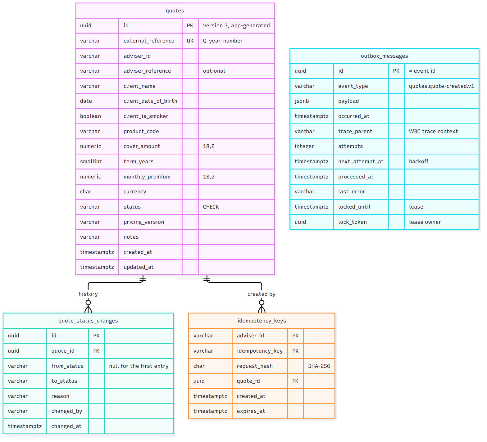
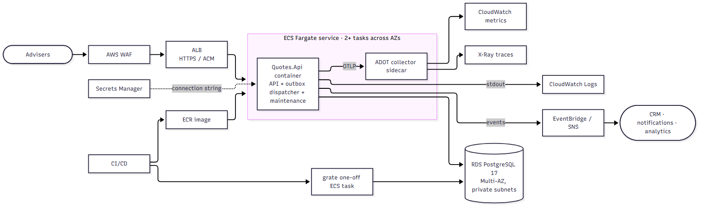

# Advisor Quotes: solution notes

A small, runnable slice of an advisor quoting capability: capture a quote, price it on the server, view and list quotes, and move a quote through its lifecycle with a full status history. Built with .NET 10, ASP.NET Core controllers and PostgreSQL 17, traced end to end with OpenTelemetry, and structured so that pricing and downstream consumers can become separate services later.

This page covers what the brief asks for: the decisions, the premium calculation, duplicate handling, schema management, the end-to-end signal (with the video walkthrough), the AWS plan, how AI tools were used and validated, and where an LLM could fit into the quote flow. The backend detail lives in [`backend/docs/`](backend/docs) and the UI detail in [frontend/README.md](frontend/README.md):

| Document | Contents |
|---|---|
| [backend/docs/architecture.md](backend/docs/architecture.md) | Layers, request flows, CQRS, the aggregate root, domain events and the outbox, designed-to-split seams |
| [backend/docs/api.md](backend/docs/api.md) | Endpoints, headers, examples, paging, every error code |
| [backend/docs/operations.md](backend/docs/operations.md) | Configuration, health checks, traces, logs, metrics, outbox runbook, migrations |
| [backend/docs/local-development.md](backend/docs/local-development.md) | Running, testing, reproducing CI, regenerating diagrams, troubleshooting |
| [backend/docs/ai-usage.md](backend/docs/ai-usage.md) | How AI assistance was used |

---

## Running it

```bash
cp .env.example .env
docker compose up --build
```

Adviser UI at http://localhost:3000, API at http://localhost:8080/api/v1/quotes, API reference at http://localhost:8080/scalar, health at `/health`, metrics at `/metrics`. Compose starts PostgreSQL, applies the migrations with grate (a one-off container), then starts the API with its two background jobs (outbox dispatcher, maintenance), and the UI. From source, without Docker, and the tests: [backend/docs/local-development.md](backend/docs/local-development.md). `backend/src/Quotes.Api/Quotes.Api.http` runs the whole demo flow. The repository layout and run order are in the [README](README.md).

---

## Architecture and key decisions


Clean architecture in four projects (Domain → Application → Infrastructure → Api, dependencies pointing inwards), grouped in the solution as `0. Tests` … `5. Shared` with the SQL scripts as a shared project. Full description: [backend/docs/architecture.md](backend/docs/architecture.md).

- **Business rules live in the domain.** `Quote` is the **aggregate root**: created only through `Quote.Create`, changed only through `ChangeStatus`, with no public setters, an immutable status history, and domain events it raises itself. Reflection tests enforce this.
- **Expected failures are values, not exceptions.** Handlers return `Result<T>`; each `Error` has a stable code (`Quote.InvalidStatusTransition`) that clients receive in RFC 9457 problem details.
- **CQRS-lite.** Commands load the aggregate through a repository and commit everything, including events, in one transaction. Queries project straight from the tables in one SQL statement and never load the aggregate. Commands return the resource (a deliberate REST convenience).
- **Ready to split.** Pricing sits behind `IPricingService` (in-process today, an HTTP or gRPC client later); downstream systems subscribe to versioned events from a **transactional outbox** instead of calling this service; reads can move behind `IQuoteReadService`.
- **Validation in two places, on purpose:** validators check request shape (field-level 400s); the domain checks rules that must hold however a quote is created.
- **SOLID in practice.** Each class has one reason to change: `CreateQuoteHandler` is only the use case (7 dependencies), duplicate detection is `IIdempotencyGuard`, and spans, metrics and logs live in `Instrumented…` decorators around the handlers (open for extension without editing them). Use cases depend on small interfaces (`IPricingService`, `IQuoteReadService`, `IIdempotencyStore`, …), never on implementations. An architecture test keeps handlers at 7 dependencies or fewer, with no logger or metrics of their own.
- **Standards:** public NuGet only, central package management, warnings as errors, the .NET **`latest-recommended` analysers enforced** (0 warnings), source-generated `[LoggerMessage]` logging, `.editorconfig` enforced in CI, architecture tests for every layer.

---

## Premium calculation

Pricing is a pure domain function (`PremiumCalculator`) over a versioned rate table from configuration:

```
monthly premium = (cover / 1000) × product rate per 1000 × age factor × smoker factor × term factor
```

- **Age** is completed years on the quote date; each age band has a factor, and an age with no band can't be quoted.
- **Smoker loading** × 1.50. **Term bands** make longer cover cost more per year.
- **Product limits:** cover range, term range, and the maximum age when cover ends (age + term).
- **Rounding** once, at the end, to 2 decimal places away from zero; `decimal` throughout.
- **Every quote stores `pricing_version`**, so a premium stays explainable after the rates change; every factor is recorded on the request's trace.
- The rate table is validated at start-up (no duplicate products, overlapping bands or non-positive factors).

| Product | Rate per R1 000/month | Cover | Term | Max age at expiry |
|---|---|---|---|---|
| TERM_LIFE | 0.30 | R100k – R10m | 5–30 years | 75 |
| SERIOUS_ILLNESS | 0.55 | R50k – R5m | 5–25 years | 70 |

Age bands: 18–30 ×0.80 · 31–40 ×1.00 · 41–50 ×1.60 · 51–60 ×2.60 · 61–65 ×4.00. Term bands: 5–10 ×0.95 · 11–20 ×1.00 · 21–30 ×1.10. The figures are illustrative, not actuarial.

Examples: R1m TERM_LIFE over 20 years, 35-year-old non-smoker: 1 000 × 0.30 × 1.00 × 1.00 × 1.00 = **R300.00**. R500k SERIOUS_ILLNESS over 15 years, 46-year-old smoker: 500 × 0.55 × 1.60 × 1.50 × 1.00 = **R660.00**.

---

## Duplicate submissions


- **With an `Idempotency-Key` header** (kept 24 hours): the same key and body return the original quote (`201`, `Idempotent-Replayed: true`); nothing new is created and no reference is used. The same key with a different body is `422 Idempotency.KeyReused`.
- **Without a header:** an identical body from the same adviser within **10 minutes** is treated as an accidental double submit and replayed. After the window it creates a new quote, because quoting the same thing twice can be intentional.
- **Normalised before hashing** (trimmed text, upper-case product code, blank optional fields as absent), so a retry with harmless differences is still a replay.
- **A new submission for the same client is not a duplicate.** A new key (or a body sent after the window) creates a new quote, because a requote is normal. The UI warns instead: it lists the client's open quotes for the same product and asks the adviser to confirm.
- **Concurrency-safe:** the quote and its idempotency record are saved in one transaction, and a primary key lets exactly one of several simultaneous identical requests win; the others return its quote. Tested with 8 parallel requests.

---

## Status lifecycle


Transitions are a table in the domain. Illegal moves are `409 Quote.InvalidStatusTransition`; declining needs a reason. Each change appends history and raises an event in the same save, and optimistic concurrency (`xmin`) turns a concurrent change into `409 Quote.ConcurrentUpdate` instead of a lost update.

---

## Persistence and schema management



- **SQL-first, run by grate.** `backend/src/dbQuotes/up/0001 … 0008` are applied once each and recorded in a `grate` schema, in a transaction; the schema evolves by adding the next script (`0005`, `0006` and `0008` alter existing tables). EF Core is used for data access only, with no EF migrations, and the app never runs DDL.
- **Configuration through the environment:** `ConnectionStrings__QuotesDb` and every other setting, validated at start-up; compose reads `.env`. Full list: [backend/docs/operations.md](backend/docs/operations.md#configuration).
- Version 7 GUIDs, `numeric(18,2)` money, `timestamptz`, `CHECK` constraints, and indexes shaped by the queries (keyset paging, adviser reference, pending outbox). Integration tests build the schema from these exact scripts, so mappings can't drift unnoticed.

---

## Domain events and the transactional outbox


Events (`quotes.quote-created.v1`, `quotes.quote-status-changed.v1`) are written to `outbox_messages` **in the same transaction** as the change, so there's never a quote without its event or an event without its quote. A background dispatcher **claims** due messages with a lease (`UPDATE … FOR UPDATE SKIP LOCKED … RETURNING`, committed at once), **publishes outside any transaction**, and records each outcome only while it still holds the lease. It's safe across instances, recovers when a dispatcher dies, backs off exponentially on failure, and **continues the original request's trace**. Locally the broker is the log; in AWS it's EventBridge or SNS. A maintenance job deletes published messages after 7 days, in batches. Details and runbook: [architecture](backend/docs/architecture.md#domain-events-and-the-outbox), [operations](backend/docs/operations.md#outbox).

---

## Runtime visibility: the end-to-end signal

**Chosen signal: OpenTelemetry distributed tracing**, with structured logs correlated by trace id.

```
POST api/v{version}/quotes                         ASP.NET Core server span
└── quote.create                                   adviser.id, idempotency.key_source, idempotency.replayed, quote.id, quote.reference
    ├── postgresql   SELECT idempotency_keys
    ├── pricing.calculate                          product, client age, age/smoker/term factors, premium, pricing version
    ├── postgresql   SELECT nextval('quote_reference_seq')
    └── postgresql   INSERT quote, history, key, outbox message (one transaction)
        ⋯ about a second later, on a background thread ⋯
        └── quotes.quote-created.v1 publish        producer span, same trace

POST api/v{version}/quotes/{quoteId}/status-changes
└── quote.status.change                            quote.id, status from/to, changed_by (error.code on a rejected change)
    ├── postgresql   SELECT quote + history
    ├── postgresql   UPDATE … AND xmin = @version; INSERT history, outbox message
    └── quotes.quote-status-changed.v1 publish
```

Why tracing: it shows timing and causality (which SQL ran for which request, where time went), it's vendor-neutral (Jaeger locally, X-Ray in AWS), and it already crosses an asynchronous boundary (the outbox), just as it will cross services once pricing is split out.

**Following a user action:** every response carries `X-Trace-Id`, and every log line carries the trace id (including the event-published line): `trace=<id>` in the text format used in Development, the `@tr` field in the JSON logs written everywhere else. Every request for a quote carries `quote.id`, so **searching Jaeger for `quote.id=<id>` lists the quote's whole lifecycle**. Business metrics complement the traces (quotes created, status changes, duplicates, rejections, premiums, outbox lag and backlog) on `/metrics`: [backend/docs/operations.md](backend/docs/operations.md#metrics).

**Video walkthrough** (set `OTEL_EXPORTER_OTLP_ENDPOINT=http://jaeger:4317` in `.env`, run `docker compose --profile observability up --build`, open http://localhost:16686):

1. Create a quote (`.http` request 1). Note `X-Trace-Id` and the quote `id`.
2. Re-send it (request 2): `Idempotent-Replayed: true`; its trace shows `idempotency.replayed=true` and no insert.
3. Send and accept the quote (requests 5–6), then try an illegal transition (request 7).
4. In Jaeger, search tag `quote.id=<id>`: one trace per request. Open the create trace: pricing factors, the SQL, and the **`quotes.quote-created.v1 publish`** span from the background dispatcher inside the same trace.
5. Open the rejected change: its `quote.status.change` span is an error with `error.code=Quote.InvalidStatusTransition`.
6. Search the API logs for the trace id (`docker logs advisor-quotes-api | Select-String <id>`): the request's log lines and the event-published line. Set `LOG_FORMAT=text` in `.env` for easier reading on camera.

---

## Adviser UI (optional part)

[`frontend/`](frontend/README.md) is a React 19 + TypeScript UI, built with Vite, shadcn/ui, TanStack Query, and React Hook Form + Zod. An adviser captures a quote, lists and filters quotes, opens one, and changes its status.

- **The API stays the authority.** The status actions on offer come from `allowedNextStatuses`. Validation errors and pricing codes from the API appear on the matching form fields.
- **Same guarantees as the API.** The form sends an `Idempotency-Key`, so a double-click or a retry replays the original quote. A `409` on a status change reloads the quote.
- **Same client, warned, not blocked.** Before capturing, the form looks up the adviser's open quotes for the same client name, date of birth and product (`GET /api/v1/quotes?…&openOnly=true`). If any exist, it lists them and asks the adviser to **Capture anyway**. Quoting a client twice on purpose (a requote, another option) stays possible.
- **Same trace.** The browser starts a W3C `traceparent` for every request, so one trace runs from the click through the API, PostgreSQL and the outbox. The UI shows the trace id as a support reference.
- **Decoupled.** It is a separate application in its own folder that only calls the HTTP API. The browser calls `/api` on the UI's own origin, and a proxy (Vite in development, nginx in the container) forwards those calls to a configured API address. One build therefore runs against any environment, and the API needs no CORS policy.
- **Production standards.** It is served by nginx with a strict Content Security Policy. axe tests check WCAG 2.2 AA. It has an error boundary and works at phone width.

Design decisions, including why Vite and not Next.js, are in its [README](frontend/README.md#design-decisions), together with how to run it.

---

## Quality and testing

`dotnet test` (in `backend/`) runs **156 tests**: **86 unit** (domain rules, aggregate guards, pricing, the idempotency guard, handlers, paging, metrics), **9 architecture** (the onion rule for every layer, a framework-free domain, controllers only on Application interfaces, focused handlers) and **61 integration** against real PostgreSQL (every endpoint and error code, parallel duplicate submissions and status changes, read projection equals aggregate, timestamps identical after a round trip, a generic 500 that leaks nothing, invalid configuration stopping start-up, versioning, OpenAPI, rate limiting with and without forwarded headers, `/metrics`, and the outbox: same-transaction writes, no lock while publishing, lease expiry and takeover, parallel dispatchers, backoff, backlog health, batched cleanup). Line coverage: Domain 96%, Application 97%, Infrastructure 91%.

CI (`.github/workflows/ci.yml`) runs formatting, a warnings-as-errors Release build, all tests with coverage, a vulnerable-package audit, compose validation and the Docker builds. A separate job runs the UI's lint, typecheck, 37 tests, build and `npm audit`. Every step also passes locally.

---

## AWS plan



| Concern | Choice | Notes |
|---|---|---|
| Compute | **ECS on Fargate**, 2+ tasks across AZs, behind an **ALB** | The existing non-root image runs unchanged; auto scaling on CPU and requests; `/health/live` for containers, `/health/ready` for targets. The outbox dispatcher and maintenance run in every task (safe by design); at higher scale they move to a worker service from the same image. |
| Database | **RDS for PostgreSQL 17**, Multi-AZ, private subnets | Backups and point-in-time recovery; Aurora for read scaling; RDS Proxy as tasks grow. |
| Migrations | **grate as a one-off ECS task** in the pipeline, before deploy | Same scripts as locally; expand-then-contract changes for safe rolling deploys. |
| Events | **EventBridge** (or SNS + SQS per consumer) | Another `IIntegrationEventPublisher`; consumers de-duplicate on the event id. |
| Secrets and config | **Secrets Manager** (rotated connection string); task-definition environment variables; SSM Parameter Store for rate tables | Nothing secret in the image or the repository. |
| Observability | **ADOT collector** sidecar: traces → **X-Ray**, metrics → **CloudWatch**; logs → **CloudWatch Logs** (already JSON outside Development, so fields such as `@tr` are queryable in Logs Insights) | No code change: set the OTLP endpoint and `Telemetry__OtlpMetrics=true`. Alarms on 5xx, p95 latency, `quotes.outbox.dead_lettered > 0`, outbox age, rejection spikes. |
| Edge and network | **WAF** on the ALB, TLS at the ALB, public subnets for the ALB only; `ForwardedHeaders__Enabled=true` with the VPC range in `ForwardedHeaders__KnownNetworks`, so rate limiting and logs see the real client IP | Authentication would be added here (Cognito or the corporate IdP). |
| Delivery | The existing GitHub Actions CI → ECR → migrate → deploy; CDK or Terraform; an account per environment | |

---

## How I used AI tools, and how I validated the output

I built this with an AI coding assistant, **Claude Code**, working in my local repository. I set the scope, the stack and the engineering standards. I scaffolded the backend from my own `architectural-patterns` skill (SOLID, clean architecture, CQRS, aggregate root, repository and unit of work, idempotency, outbox, observability). The assistant wrote most of the code, all of the unit tests, and the documentation at my direction, through repeated rounds of review and change.

I didn't take the output on trust. Here's how it was checked:
- **156 automated tests**, including integration tests against real PostgreSQL and concurrency tests for duplicate submissions, status changes and outbox dispatchers.
- **Architecture tests that fail the build** if a layer rule is broken. I checked that these guard tests catch real violations by deliberately breaking the code.
- **Every CI step run locally:** formatting, a warnings-as-errors build, the vulnerable-package audit and the Docker builds.
- **The running system checked end to end:** API responses, logs, Jaeger traces, metrics and the database itself.
- **Comparisons with my own earlier solutions**, followed by fixes.

The full account is in [backend/docs/ai-usage.md](backend/docs/ai-usage.md).

---

## Where an LLM or AI agent could fit

**The premium calculation should stay deterministic.** It has to be exact, repeatable and auditable, and an LLM is none of those. AI fits *around* the quote flow as an assistant whose output an adviser checks. Three places would work well:
- **Capture:** turn an adviser's free-text notes or a client document into a pre-filled quote form, confirmed by the adviser before submission.
- **Communication:** draft the plain-language summary or email when a quote moves to `SentToClient`.
- **Questions:** an agent with **read-only** tools over this API ("which of my quotes are still in draft?"). It wouldn't get write access to status changes.

The natural integration point already exists: a consumer of the outbox events (`quote-created`, `quote-status-changed`) runs the model **asynchronously**, so the create and status calls never wait for it. The trade-offs:
- **Cost:** every call is paid per token. Generate only on demand or on specific events, use a small model where it's good enough, and cache results per quote version.
- **Latency:** model calls take seconds, not the milliseconds the API needs. Keep them off the request path: event-driven, streamed to the UI, with a timeout and a fallback, so quoting works when the model is slow or down.
- **Data privacy:** quotes contain personal and health-related data (name, date of birth, smoker status), which falls under POPIA. Send the minimum, pseudonymise identifiers, use a provider that doesn't train on the data and runs in an approved region (for example Amazon Bedrock inside the AWS account), and keep prompts out of logs. A human stays accountable for anything that reaches a client.

---

## Trade-offs and next steps

- **Authentication and authorisation are out of scope.** `adviserId` and `changedBy` would come from the token, advisers would see only their own quotes, and rate limiting would partition by adviser.
- **Fingerprint dedupe can, rarely, merge two genuine identical quotes** within 10 minutes; clients that need precision send `Idempotency-Key`.
- **At-least-once events:** a consumer may see an event twice; the event id makes de-duplication easy.
- **Reference numbers can have gaps** (a sequence value used by a failed request). Uniqueness matters more than continuity.
- **A retried status change after an unknown commit** can surface as `409 Quote.ConcurrentUpdate` although it succeeded; the client reloads. Preferable to a lost update.
- **Next:** an `Expired` status driven by a scheduled job; contract tests once pricing is split out; a sliding-window rate limiter if bursts at window edges matter.
