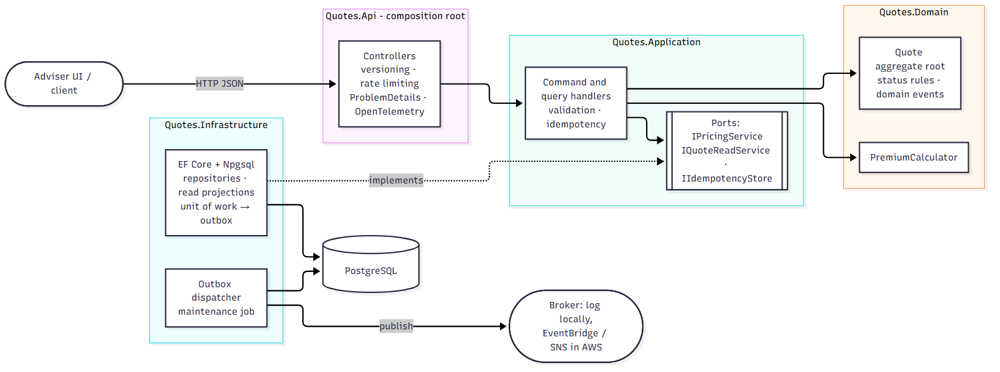
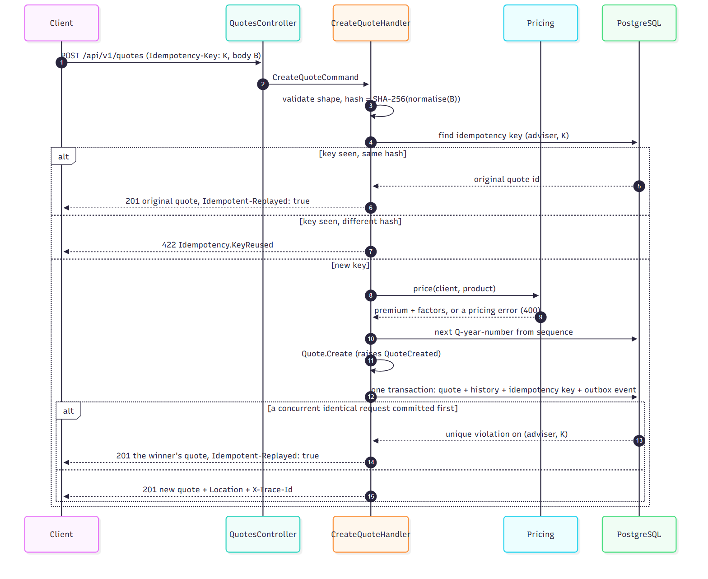
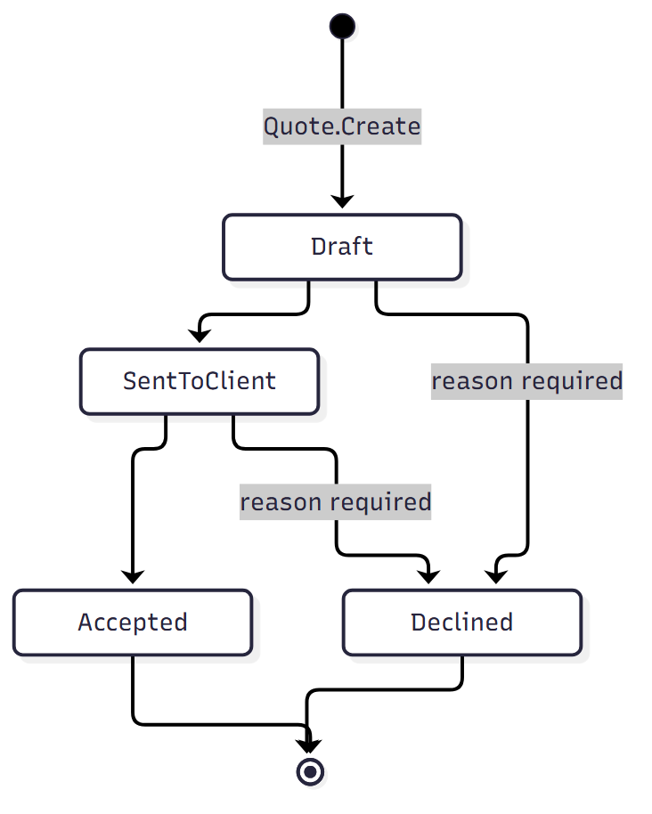
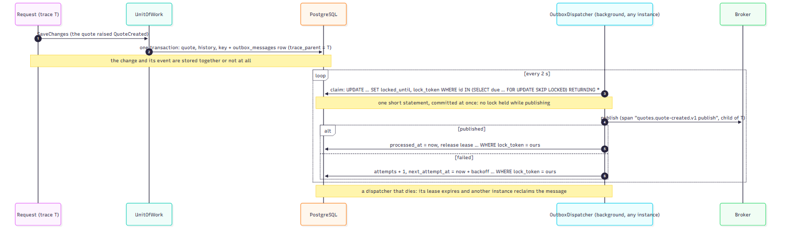
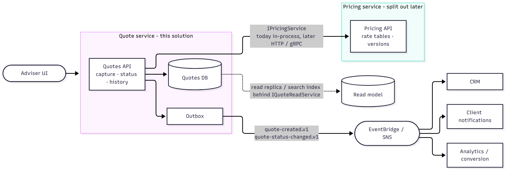

# Architecture

How the code is organised and what happens when it runs. The summary of decisions is in [SOLUTION.md](../../SOLUTION.md).

**On this page:** [Layers](#layers) · [Where things live](#where-things-live) · [Creating a quote](#creating-a-quote) · [Changing a status](#changing-a-status) · [Reading quotes](#reading-quotes) · [Aggregate root](#the-aggregate-root) · [Domain events and the outbox](#domain-events-and-the-outbox) · [Designed to split](#designed-to-split) · [Patterns](#patterns-used) · [How the rules are enforced](#how-the-rules-are-enforced)

## Layers



<sub>Source: [diagrams/flow/solution-architecture.mermaid](diagrams/flow/solution-architecture.mermaid)</sub>

Clean (onion) architecture: business rules in the middle, technology at the edges, every dependency pointing inwards.

| Layer (project) | Responsibility | May reference |
|---|---|---|
| **Domain** (`Quotes.Domain`) | The `Quote` aggregate root, `StatusChange`, transition rules, value objects (`ClientDetails`, `ProductDetails`, `Money`), `PremiumCalculator`, domain events, `Result`/`Error`, repository interfaces. No framework code. | nothing |
| **Application** (`Quotes.Application`) | One handler per use case (create, change status, get, list), validation, idempotency, request/response models, the ports the outer layers implement, trace spans and business metrics. | Domain |
| **Infrastructure** (`Quotes.Infrastructure`) | Implements the ports: EF Core + Npgsql, read projections, the unit of work (outbox + error translation), the reference sequence, rates from configuration, the outbox dispatcher, the maintenance job, health checks. | Application, Domain |
| **Presentation** (`Quotes.Api`) | The ASP.NET Core host: controllers, versioning, rate limiting, ProblemDetails, OpenAPI, OpenTelemetry, Serilog, Prometheus, and the dependency injection wiring (the composition root). | Application, Infrastructure |

The compiler enforces most of this (a project can only use what it references), and `Quotes.ArchitectureTests` fails if any assembly references an outer layer, if the Domain references any framework, if Application references persistence, web or telemetry libraries, or if a controller depends on anything other than an Application interface.

## Where things live

Each folder is a namespace (`src/Quotes.Domain/Entities` is `Quotes.Domain.Entities`).

```
src/Quotes.Domain/
  Entities/        Quote (aggregate root), StatusChange
  Commands/        CreateQuote, ChangeQuoteStatus: the inputs that create or change the aggregate
  Events/          QuoteCreated, QuoteStatusChanged
  ValueObjects/    ClientDetails, ProductDetails, Money
  Rules/           QuoteStatusTransitions (the state machine table)
  Pricing/         PremiumCalculator, RateTable, ProductRate, FactorBand
  Errors/          QuoteErrors, PricingErrors, ErrorCodes (stable codes)
  Repositories/    IQuoteRepository (persistence of the aggregate)
  Common/          AggregateRoot, IDomainEvent, Result, Error
  Observability/   Messages: ResponseMessages, ErrorMessages, WarningMessages, InfoMessages, AuditMessages, MessageFormatter

src/Quotes.Application/
  Handlers/        CreateQuote, ChangeQuoteStatus (commands) · GetQuote, ListQuotes (queries)
  Models/          Request/V1 (HTTP binding), Commands, Queries, Response/V1, Results
  Validators/      FluentValidation, one per request
  Idempotency/     IIdempotencyGuard + IdempotencyGuard, IdempotencyCheck, IdempotencyRecord, options, RequestHasher
  Interfaces/      IUnitOfWork (one transaction per use case), IPricingService, IQuoteReadService, IIdempotencyStore,
                   IRateTableProvider, IQuoteReferenceGenerator
  Pricing/         LocalPricingService (in-process implementation of IPricingService)
  Observability/   Instrumented… decorators (spans, metrics, logs), QuotesTelemetry, QuotesMetrics, ApplicationLog

src/Quotes.Infrastructure/
  Persistence/     QuotesDbContext, mappings, repositories, QuoteReadService, UnitOfWork, QuoteReferenceGenerator
  Messaging/       outbox: OutboxMessage, IntegrationEvents, OutboxDispatcher (+ background service), backlog, health check
  Maintenance/     DatabaseMaintenance (+ background service)
  Pricing/         PricingOptions (+ validator), ConfigurationRateTableProvider
  Constants/       ConnectionStringNames, HealthCheckNames, HealthCheckTags, HealthCheckDataKeys

src/Quotes.Api/
  Controllers/     QuotesController, ApiControllerBase (Result → problem details)
  Extensions/      API/versioning/OpenAPI, telemetry, health, Prometheus
  RateLimiting/    per-client fixed window
  Networking/      forwarded headers (trusted proxies and networks)
  Logging/         Serilog set-up (text in Development, JSON elsewhere), ApiLog
  ErrorHandling/   GlobalExceptionHandler

src/dbQuotes/up/   0001 … 0008: the schema, applied by grate
```

## Creating a quote



<sub>Source: [diagrams/flow/create-quote.mermaid](diagrams/flow/create-quote.mermaid)</sub>

1. The controller binds the body and the optional `Idempotency-Key` header into a `CreateQuoteCommand`. It calls the registered handler, which is `InstrumentedCreateQuoteHandler` (span, metrics, logs) wrapping `CreateQuoteHandler` (the use case).
2. The handler validates the request shape (field-level 400s).
3. `IIdempotencyGuard.CheckAsync` hashes the normalised request (trimmed text, upper-case product code, cover amount at two decimal places, blank optional fields absent) and looks up `(adviser, key)`, or `(adviser, body fingerprint)` without a key. Its decision: go ahead, replay the earlier quote, or reject (key too long, or `422` for the same key with a different body).
4. Otherwise the handler prices the quote through `IPricingService` (product limits are domain rules, returned as 400), takes the next `Q-<year>-<number>` from a sequence, and calls `Quote.Create`, which checks invariants, records the first history entry and raises `QuoteCreated`.
5. `IIdempotencyGuard.Remember` stages the key, and the unit of work saves the quote, its history, the idempotency record and the outbox message in **one transaction**. If a concurrent identical request committed first, the primary key on `idempotency_keys` rejects ours, and `RecheckAfterConflictAsync` turns that into a replay of the winner's quote. The save runs through EF's retrying execution strategy with a **commit check**: if the connection drops during the commit itself, the unit of work looks for the save's outbox row before retrying, so a transaction that did commit is never written a second time.

## Changing a status



<sub>Source: [diagrams/flow/quote-lifecycle.mermaid](diagrams/flow/quote-lifecycle.mermaid)</sub>

`ChangeQuoteStatusHandler` loads the aggregate (with its history) and calls `quote.ChangeStatus(...)`. The aggregate checks the transition table, requires a reason for a decline, appends a `StatusChange`, updates the status and raises `QuoteStatusChanged`. All of it is saved together; the update carries `AND xmin = <version read>`, so a concurrent change returns `409 Quote.ConcurrentUpdate` instead of being overwritten.

## Reading quotes

Queries never load the aggregate. `QuoteReadService` projects straight from the tables into response models, each in **one SQL statement** without change tracking: the quote joined to its ordered history for `GET /quotes/{id}`, and the summary columns with keyset paging for the list. `allowedNextStatuses` is added afterwards from the same transition table the aggregate uses. An integration test proves the projection equals the aggregate mapped with `QuoteResponse.FromDomain`, field for field.

## The aggregate root

`Quote` derives from `AggregateRoot` and is the only way in:

- created only through `Quote.Create` (no public constructors), changed only through `ChangeStatus`
- no public setters; values fixed at creation are `init`-only; only `Status` and `UpdatedAt` change
- `StatusChange` has internal or private constructors only and is immutable
- the history and the domain events are exposed read-only; events are raised only by the aggregate (`Raise` is protected)
- one repository, for the root only; other records (idempotency, outbox) refer to a quote **by id**, never by navigation

Reflection tests enforce every point above.

## Domain events and the outbox



<sub>Source: [diagrams/flow/outbox.mermaid](diagrams/flow/outbox.mermaid)</sub>

- **Raised by the aggregate**, collected by the unit of work from tracked aggregates and written to `outbox_messages` in the same transaction as the change. Handlers never deal with events.
- **Versioned contracts:** `quotes.quote-created.v1`, `quotes.quote-status-changed.v1`. The payload is JSON with string enums; the row id is the event id, so consumers can de-duplicate (delivery is at least once).
- **Claim with lease:** a dispatcher claims a batch with one statement, `UPDATE … SET locked_until, lock_token WHERE id IN (SELECT … FOR UPDATE SKIP LOCKED) RETURNING *`, which commits immediately. It then publishes **outside any transaction**, so a slow broker never holds a lock. Each outcome is saved on its own with `… AND lock_token = ours`.
- **Safe with many instances:** `SKIP LOCKED` hands each message to one dispatcher. A dispatcher that dies leaves its lease to expire, after which any instance reclaims the message; if the old dispatcher wakes up, the `lock_token` check rejects its late result.
- **In order per quote:** each message carries its `aggregate_id`, and the claim skips a message while an earlier one for the same quote is unpublished, so a consumer never sees `quote-status-changed` before `quote-created`. Messages for different quotes don't wait for each other. A dead-lettered message holds back the later events of its quote until it is re-driven.
- **Database clock:** leases and retry times are on PostgreSQL's clock (read once per batch), so instances with skewed clocks still agree on when a lease expires.
- **Exponential backoff** on failure (5 s → 5 min, 20 attempts). A message that runs out of attempts is kept for investigation and reported by the outbox health check and the `quotes.outbox.dead_lettered` gauge.
- **The trace continues:** the request's W3C trace context is stored with the message, so the publish span sits inside the original request's trace.
- **Locally, the broker is the log** (`LoggingIntegrationEventPublisher`); in AWS an EventBridge or SNS publisher replaces it behind `IIntegrationEventPublisher`.

Operating it (backlog, re-driving dead-lettered messages, retention) is described in [operations.md](operations.md#outbox).

## Designed to split



<sub>Source: [diagrams/flow/target-services.mermaid](diagrams/flow/target-services.mermaid)</sub>

| Seam | Today | Later |
|---|---|---|
| `IPricingService` | `LocalPricingService` runs `PremiumCalculator` in-process | an HTTP or gRPC client to a separate pricing service; the handlers don't change |
| Outbox events | published to the log | EventBridge or SNS; CRM, notifications and analytics subscribe without this service knowing them |
| `IQuoteReadService` | projections on the primary database | a read replica or search index |
| `IRateTableProvider` | rates from configuration | a rates database or the pricing service |

Every quote stores `pricing_version`, so premiums stay explainable after pricing moves.

## SOLID in practice

| Principle | Where it shows |
|---|---|
| **Single responsibility** | `CreateQuoteHandler` is only the use case; duplicate detection is `IdempotencyGuard`; spans, metrics and logs are in the `Instrumented…` decorators; persistence errors are translated in `UnitOfWork`; the outbox claim, publish and record steps are in `OutboxDispatcher`, scheduling in `OutboxDispatcherService`. |
| **Open/closed** | Behaviour is added by wrapping, not editing: the decorators around the handlers, `MicrosecondPrecisionTimeProvider` around the system clock, and new publishers or pricing sources behind existing interfaces. |
| **Liskov substitution** | Every implementation can stand in for its interface: the in-memory test store for the repository, read service, idempotency store and unit of work; a recording publisher for the broker; the precision clock for `TimeProvider`. The tests rely on this. |
| **Interface segregation** | Small ports, each with one client concern: writes (`IQuoteRepository`) are separate from reads (`IQuoteReadService`), idempotency storage (`IIdempotencyStore`) from the guard's decisions (`IIdempotencyGuard`), and rates (`IRateTableProvider`) from pricing (`IPricingService`). |
| **Dependency inversion** | Use cases depend only on Domain and Application interfaces; Infrastructure and the API implement and wire them. Enforced by the architecture tests. |

`Quotes.ArchitectureTests` also keeps use-case handlers at **7 dependencies or fewer**, with **no logger or metrics of their own**: a cheap guard against a handler quietly collecting responsibilities again.

## Patterns used

| Pattern | Where | Why |
|---|---|---|
| Aggregate root | `Quote` | One consistency boundary for status, history and events |
| Value objects | `Money`, `ClientDetails`, `ProductDetails` | Compared by value, immutable; `Money` can only be created rounded |
| Result / error codes | `Result<T>`, `Error` | Expected failures as values with stable codes; exceptions only for faults |
| CQRS-lite | command vs query handlers, `IQuoteRepository` vs `IQuoteReadService` | Rules on writes, cheap projections on reads |
| Ports and adapters | `Interfaces/` in Application, implementations in Infrastructure | The core never depends on technology |
| Unit of work | `UnitOfWork` | One transaction per use case, including the outbox |
| Transactional outbox | `outbox_messages` + dispatcher | No lost or phantom events |
| Idempotency key | `IIdempotencyGuard` + `idempotency_keys` | Safe retries and double-submit protection |
| Decorator | `InstrumentedCreateQuoteHandler`, `InstrumentedChangeQuoteStatusHandler`, `MicrosecondPrecisionTimeProvider` | Add cross-cutting behaviour without touching the decorated class |
| Optimistic concurrency | `xmin` row version | No lost updates, no locks held between read and write |
| Strategy-like seam | `IPricingService`, `IRateTableProvider`, `IIntegrationEventPublisher` | Swap the implementation without touching use cases |

## How the rules are enforced

| Rule | Enforced by |
|---|---|
| Layer dependencies | project references + `Quotes.ArchitectureTests` |
| Aggregate encapsulation | reflection tests in `Quotes.UnitTests/Domain/AggregateRootTests` |
| Focused handlers | `Quotes.ArchitectureTests` (at most 7 dependencies, no logger or metrics) |
| Code style | `.editorconfig` + `dotnet format --verify-no-changes` in CI |
| Code quality | .NET `latest-recommended` analysers + `TreatWarningsAsErrors` (0 warnings); test projects only relax test-naming rules |
| Schema matches the mappings | integration tests build the schema from `src/dbQuotes/up` and exercise every endpoint |
